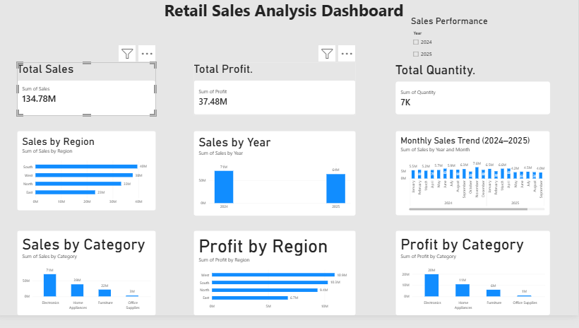

# Retail Sales Analysis Dashboard

## Project Overview
This project analyzes retail sales data from 2024 to 2025 using Microsoft Excel and Power BI. The goal is to understand sales performance, profitability, and trends to support better business decisions.

## Tools Used
- Microsoft Excel
- Microsoft Power BI
- PivotTables and PivotCharts
- Data Cleaning and KPI Analysis

## Project Activities
- Cleaned the dataset and removed duplicate records.
- Handled missing values and inconsistent data.
- Analyzed sales and profit by region and product category.
- Compared sales performance across years.
- Created an interactive Power BI dashboard with KPI cards, charts, and a year slicer.

## Key Metrics
- Total Sales: Approximately ₹13.42 crore in the Excel analysis.
- Total Profit: Approximately ₹3.75 crore in the Excel analysis.
- Profit Margin: Approximately 28%.
- Analysis Period: 2024–2025.

*Note: Validate that the Power BI totals match the Excel analysis before publishing final results.*

## Business Insights
The analysis helps identify sales trends, compare regional and category performance, and highlight products that may need further investigation.

## Project Status
Completed initial Excel analysis and Power BI dashboard development. Further validation of totals and filters is recommended.

## Dashboard Preview

